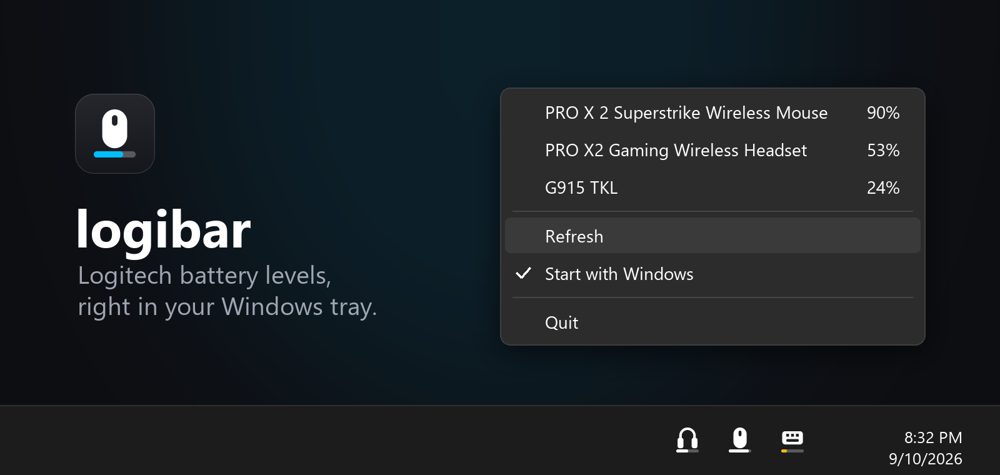

# 🔋 logibar

Logitech mouse and headset battery right in your Windows tray. Written in Rust 🦀, tiny, no setup.



## ⬇️ Get it

Grab [`logibar.exe`](https://github.com/canmenzo/logibar/releases/latest/download/logibar.exe) and run it. That's it.

Want it installed and starting with Windows? Download all the files from the [latest release](https://github.com/canmenzo/logibar/releases/latest) into one folder and run `.\install.ps1`.

## 🖱️ How it works

- One tray icon per device: mouse 🖱️, headset 🎧, keyboard ⌨️ if you have one
- Bar turns 🟡 at 30% and 🔴 at 15%, plus a heads-up notification
- Click an icon for percentages, Refresh, Start with Windows, Quit

It just reads G HUB's local data, so G HUB needs to be installed. No account, no internet.

## 🛠️ Build it yourself

```powershell
.\build.ps1
```

Needs Rust and the Visual Studio C++ build tools. Options: `logibar.exe --help`.

## 📄 License

[MIT](LICENSE). Not affiliated with Logitech.
